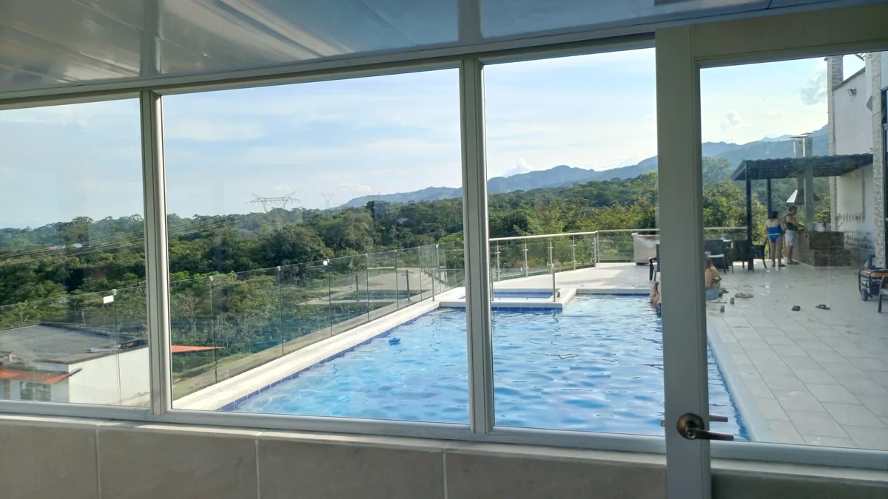

# ROADMAP — Villa Pecas

> Documento de trabajo para el agente implementador. Léelo completo antes de tocar código.
> Cada tarea indica archivos, cambio exacto y criterio de aceptación. Si algo no está aquí,
> no se inventa: se anota en **§7 Datos pendientes** y se pregunta.

Última actualización: **revisión CRO del 27/11/2026**, sobre `main` = `2d56aad`
(fase 4 de CRO ya publicada en GitHub Pages). Rama de trabajo: `feat/cro-final`,
fast-forward sobre `main`.

Modelo confirmado por el dueño: **casa completa** (exclusiva), con equivalente por
persona y negociación caso a caso para grupos menores de 22. **Sin mínimo de personas
ni de noches.**

Este documento sustituye la versión anterior. Los cambios de esta revisión están
listados en **§11**.

---

## 0. Contexto fijo de negocio

**Reglas que no se cambian sin autorización explícita del dueño.**

| Regla | Valor |
| --- | --- |
| Precio publicado | **$1.320.000 COP por noche**, casa completa hasta 22 personas |
| Equivalencia | **$60.000 por persona** con las 22 plazas (aritmética, no tarifa) |
| Capacidad | **Hasta 22 personas** (7 habitaciones: 6 triples + 1 cuádruple con baño privado) |
| Mínimo de personas | **No existe** |
| Mínimo de noches | **No existe** |
| Modalidad | **Siempre la casa completa**, exclusiva para el grupo. No se alquilan habitaciones sueltas |
| Grupos de menos de 22 | **Precio negociable**, sin tarifa fija publicada |
| Temporada baja | Tarifas especiales, se negocian por WhatsApp |
| Ubicación pública | Restrepo, Meta (límite con Cumaral). La dirección exacta **no se publica** |
| Reseñas | **No hay reseñas reales.** No inventar ni maquetar testimonios |
| Fotos | **No cambian** en esta etapa (las 15 actuales de `assets/optimizado/`) |
| Canal de venta | WhatsApp `+57 310 813 7862` (`wa.me/573108137862`) |

### 0.1 Cómo se comunica el precio

El producto es **la casa completa**, exclusiva para el grupo. La referencia publicada es
**$1.320.000 COP por noche** para las 22 plazas, que equivale a $60.000 por persona. Un
grupo más pequeño **negocia**: no hay tabla de precios ni tarifa por cabeza que prometer.

Reglas:

- La cifra protagonista es el **total de la casa**, siempre acompañada de "hasta 22 personas".
- El equivalente por persona se muestra **condicionado**: "si vienen los 22, sale a
  $60.000 por persona". Es aritmética, no una tarifa.
- **Prohibido prometer precio proporcional** ("10 personas = $600.000"), prometer
  descuentos automáticos o escribir frases como *"pagas solo por las personas que vienen"*.
  El dueño negocia caso a caso y la web no puede cerrar esa puerta.
- **Prohibida la tabla de precios por tamaño de grupo.** Fijaría un precio proporcional
  que el dueño no ha autorizado. Se evaluó y se descartó (ver §11).
- **Prohibido "Desde" / "From"** delante de la tarifa: la casa tiene un precio, y una
  temporada baja que se negocia no autoriza a anunciar un piso.
- La salida para grupos pequeños es el CTA: "¿Vienen menos? Escríbenos y lo ajustamos".
  Es la consulta que interesa, no un número inventado.
- La villa **nunca se comparte** con otros huéspedes: la exclusividad es un argumento de
  venta y es cierta.
- "Sin mínimo de personas ni de noches" es cierto, es diferencial y **debe aparecer**
  (hero y bloque de tarifas): es la objeción más frecuente en alquiler de casa completa.
- Temporada baja: se invita a negociar, jamás se publica un número.

### 0.2 Lo que nunca se escribe

- Un precio por persona como tarifa cerrada (solo como equivalencia condicionada a 22).
- Prometer tarifa proporcional, descuento automático o "precio por cabeza".
- Una tabla "N personas → $X".
- Toallas, "menaje" o dotación no confirmada.
- Metros cuadrados, año de construcción, número de RNT ni políticas de cancelación
  mientras estén en §7.
- Reseñas, notas o testimonios inventados.
- Distancias o tiempos de viaje (Villavicencio, Bogotá, aeropuerto) mientras estén en §7.

### 0.3 Decisiones de esta revisión

Trazabilidad entre el informe de conversión y las tareas de este documento.

| Hallazgo del informe | Decisión | Tarea |
| --- | --- | --- |
| "Desde $1.320.000" es el techo, no el suelo | Eliminar "Desde" de los 4 sitios donde aparece | 1.2 |
| El precio no dice cuánto paga un grupo menor | Equivalencia condicionada + CTA de ajuste | 1.1, 1.6 |
| 13 enlaces a WhatsApp con 4 mensajes distintos | Un mensaje genérico + variantes de tarjeta controladas | 1.3 |
| El hero grita la marca (128 px) y susurra la propuesta (16 px) | Subir el *claim* y reescribirlo con datos | 1.4 |
| No hay condiciones de reserva | Bloque `#condiciones` | 1.5 |
| "Nosotros" gasta una pantalla sin decir nada | Reemplazo por argumentos verificables | 1.7 |
| Sin `sitemap.xml` ni `robots.txt` | Añadirlos | 2.1, 2.2 |
| La `og-image` es una foto sin marca ni oferta | Rehacerla con claim y tarifa | 2.4 |
| La galería muestra 7 fotos sin ampliación | Orden + ampliación con `<dialog>` nativo | 2.5 |
| El aviso de cookies tapa el precio en la 1.ª visita y oculta la barra móvil | No pedir consentimiento si no hay etiqueta; si la hay, no tapar el CTA | 2.6 |
| Etiquetas de navegación inconsistentes; falta contacto directo | Unificar y añadir `tel:` | 2.7 |
| No hay prueba social posible todavía | Bloqueada, con requisitos explícitos | §5 |

**Descartado a propósito** (y por qué):

- **Tabla de precios por tamaño de grupo:** contradecía la regla del dueño. El informe la
  proponía como palanca de claridad; con el modelo validado habría fijado un precio
  proporcional no autorizado.
- **Rediseño visual:** la base tipográfica y de color funciona. El problema es contenido.
- **Motor de reservas, calendario, pagos en línea:** una sola propiedad que se vende por
  WhatsApp no los necesita.

---

## 1. Arquitectura del proyecto

Sitio estático bilingüe en GitHub Pages. **Sin build, sin frameworks, sin dependencias.**

```
index.html          → versión española  (canonical: .../villa-pecas-landing/)
en/index.html       → versión inglesa   (canonical: .../en/)
style.css           → única hoja de estilos, compartida por las dos
js/main.js          → carrusel de galería + menú + memoria de idioma
js/analytics.js     → banner de consentimiento + GA4 (sin ID todavía)
assets/optimizado/  → 15 imágenes WebP en uso
assets/og-image.jpg → 1200x630 para redes
scripts/            → utilidades de desarrollo (no se sirven)
  optimizar_imagenes.py
  verify.py         → puerta de verificación de §8
```

### Estructura obligatoria que no se toca

- `<html lang="es">` / `<html lang="en">`.
- Tres `<link rel="alternate" hreflang>` (es, en, x-default) **en las dos páginas**,
  con URLs absolutas a `https://estebanbogota338.github.io/villa-pecas-landing/…`.
- `canonical` autorreferente en cada versión.
- Dos bloques JSON-LD por página: `LodgingBusiness` y `FAQPage`.
- Los `id` de sección son los mismos en ambos idiomas
  (`#inicio`, `#precios` *(nuevo, §2.7)*, `#nosotros`, `#espacios`, `#galeria`, `#faq`,
  `#condiciones` *(§1.5)*, `#contacto`).
- Un solo `<h1>` por página.

### Bilingüe = dos archivos

**Todo cambio de contenido se aplica en `index.html` y en `en/index.html`.**
No hay generador: el HTML está duplicado a propósito para que Google indexe
cada idioma sin JavaScript. Si el agente toca uno y no el otro, es un bug.

---

## 2. Reglas de implementación

1. **Cero dependencias nuevas.** Nada de librerías, ni CDN, ni fuentes extra.
2. **Accesibilidad AA**: cualquier texto nuevo cumple contraste ≥ 4,5:1 (≥ 3:1 en
   texto ≥ 24 px). Áreas táctiles ≥ 44×44 px. Foco visible siempre.
3. **Sin JS para contenido**: si se puede con HTML/CSS nativo (`<details>`, `<a>`),
   no se usa JavaScript. La única excepción admitida es la ampliación de galería con
   `<dialog>` (§2.5).
4. **Sin CLS**: todo `` nuevo lleva `width` y `height` (o contenedor con
   `aspect-ratio`). Nada nuevo por encima del hero.
5. **No romper el LCP**: el hero es `.hero-background` con `preload` en el `<head>`.
   No se añaden imágenes ni scripts antes de esa precarga.
6. **Español neutro de Colombia.** Nada de `tú`/`vos` mezclados; se usa `tú`.
7. Cada tarea = **un commit atómico** en una rama `feat/*`. `main` solo por merge.
8. **Ningún texto de precio lleva "Desde" / "From".**
9. **La cifra por persona siempre condicionada** a las 22 plazas, en la misma frase.
10. **El *claim* del hero no baja de 1,25 rem** (ver §1.4): es la línea que vende.
11. **Toda afirmación nueva debe ser verificable** con los datos de §0. Si no lo es,
    va a §7 y no se escribe.

---

## 3. FASE 1 — Conversión (prioridad ALTA)

### 1.1 Bloque de tarifas definitivo

**Archivos:** `index.html`, `en/index.html`
**Estado:** abierta
**Objetivo:** que la tarifa se entienda en 5 segundos: **la casa completa**, hasta 22
personas, sin mínimos, con el equivalente por persona condicionado y una salida clara
para grupos pequeños.

- [ ] Localizar `<section class="price-band" …>` (justo después del hero). **No cambiar
      clases ni estructura**: solo textos y **un** elemento nuevo (`-detail`, §3.1.b).
- [ ] Dejar el contenido exacto:

| Elemento | Español | English |
| --- | --- | --- |
| `.price-band-eyebrow` | `TARIFA DE TEMPORADA ALTA` | `HIGH-SEASON RATE` |
| `.price-band-amount` | `$1.320.000` | `COP $1,320,000` |
| `.price-band-unit` | `COP / noche · casa completa` | `/ night · whole villa` |
| `.price-band-detail` *(nuevo)* | `Si vienen los 22, sale a $60.000 por persona. ¿Vienen menos? Escríbenos y lo ajustamos.` | `With all 22 guests it works out to COP $60,000 per person. Coming with fewer? Message us and we will adjust it.` |
| `.price-band-note` | `Piscina, turco, BBQ y 7 habitaciones con baño privado: la casa es solo para tu grupo. Sin mínimo de personas ni de noches. En temporada baja tenemos tarifas especiales: pregúntanos por WhatsApp.` | `Pool, steam room, BBQ and seven en-suite bedrooms: the villa is yours alone. No minimum guests, no minimum nights. In low season we have special rates — just ask us on WhatsApp.` |
| `.price-band-cta` | `Consultar disponibilidad →` | `Check availability →` |

> ⚠️ **Corrección respecto a la versión anterior de este documento.** La nota decía
> *"Pagas solo por las personas que vienen"*. Eso promete precio proporcional, que §0
> prohíbe y que el dueño no ha autorizado. Sustituida por la redacción de la tabla.
> El resto del bloque no cambia.

- [ ] Actualizar la nota del bloque de contacto (`.contact-price-note`):

| Español | English |
| --- | --- |
| `Tarifa de temporada alta por la casa completa, hasta 22 personas: $1.320.000 por noche. Sin mínimo de personas ni de noches. En temporada baja hay tarifas especiales: escríbenos y lo ajustamos.` | `High-season rate for the whole villa, up to 22 guests: COP $1,320,000 per night (about US$330 at COP 4,000 per dollar — you are always charged in Colombian pesos). No minimum guests, no minimum nights. In low season we have special rates: message us and we will adjust it.` |

> ⚠️ **Corrección respecto a la versión anterior.** La nota inglesa empezaba con
> *"High-season rate per person"*, que contradecía el modelo de casa completa.

#### 3.1.b Elemento nuevo: equivalencia y salida para grupos pequeños

Se inserta **entre** `.price-band-unit` y `.price-band-note`, una sola vez por página:

```html
<p class="price-band-detail">
    Si vienen los 22, sale a <strong>$60.000</strong> por persona.
    ¿Vienen menos? Escríbenos y lo ajustamos.
</p>
```

```css
.price-band-detail {
    margin: 16px auto 0;
    max-width: 560px;
    color: var(--gold-light);   /* 4.55:1 sobre verde oscuro */
    font-size: 0.95rem;
    line-height: 1.6;
    letter-spacing: 0.3px;
}

.price-band-detail strong {
    font-weight: 500;
}
```

Cumple dos funciones: da el equivalente por persona (aritmética, no tarifa) y ofrece la
negociación a quien viene con menos gente. Va **debajo** del total.

#### 3.1.c Fuentes de verdad del precio

Si la tarifa cambia, se actualiza en **los seis sitios de cada idioma**:

| # | Dónde | Valor |
| --- | --- | --- |
| 1 | Banda de tarifa | `.price-band-amount` → total de la casa |
| 2 | Banda de tarifa | `.price-band-detail` → equivalente por persona con 22 |
| 3 | Ficha de contacto | `.contact-detail-value` de la ficha `CASA COMPLETA` / `WHOLE VILLA` |
| 4 | Barra móvil | `.mobile-bar-amount` + `.mobile-bar-unit` → total |
| 5 | JSON-LD | `priceRange` del bloque `LodgingBusiness` → total |
| 6 | FAQ 3 | texto visible **y** `mainEntity[2].acceptedAnswer.text` |

Formato exacto, sin mezclar:

| Concepto | Español | English |
| --- | --- | --- |
| Total 22 plazas | `$1.320.000` | `COP $1,320,000` |
| Equivalente por persona | `$60.000` | `COP $60,000` |

**Criterio de aceptación:** la cadena "sin mínimo" / "no minimum" aparece al menos una vez
por página, los seis puntos coinciden dentro de cada idioma, y la cifra por persona
aparece **solo** como equivalencia condicionada a las 22 plazas (lo comprueba
`scripts/verify.py`).

---

### 1.2 Eliminar "Desde" / "From" del precio

**Archivos:** `index.html`, `en/index.html`
**Estado:** abierta
**Motivo:** la casa tiene un precio fijo. "Desde" solo tiene sentido si existe una tarifa
por debajo, y la temporada baja se negocia en WhatsApp, no se publica. Escrito "Desde",
$1.320.000 se lee como suelo cuando en realidad es el techo.

Ocurrencias reales hoy (4 en total):

| Archivo | Antes | Después |
| --- | --- | --- |
| `index.html` | `<span class="mobile-bar-label">Desde</span>` | `<span class="mobile-bar-label">Tarifa</span>` |
| `en/index.html` | `<span class="mobile-bar-label">From</span>` | `<span class="mobile-bar-label">Rate</span>` |
| `index.html` | `"priceRange": "Desde $1.320.000 COP por noche (casa completa)"` | `"priceRange": "$1.320.000 COP por noche (casa completa, hasta 22 personas)"` |
| `en/index.html` | `"priceRange": "From COP 1,320,000 per night (whole villa)"` | `"priceRange": "COP 1,320,000 per night (whole villa, up to 22 guests)"` |

> ⚠️ **No tocar** las apariciones dentro de textos de `alt` o copy
> (`"…desde el turco de Villa Pecas"`, `"…from the steam room…"`). Solo el precio.

**Criterio de aceptación:**

```bash
grep -n ">Desde<\|Desde \$" index.html      # sin resultados
grep -n ">From<\|From COP" en/index.html    # sin resultados
```

---

### 1.3 Unificar los CTA de WhatsApp

**Archivos:** `index.html`, `en/index.html`
**Estado:** abierta
**Situación:** hay **13 enlaces `wa.me` por página** con **4 mensajes distintos**. Tres de
ellos son casi idénticos, pero el de las tarjetas dice *"me interesa la Piscina"*, que en
un modelo de casa completa suena a que se alquila la piscina por separado.

**Plantilla única** (dos variantes, sin excepciones):

```python
# Generador de URLs. Usar la salida VERBATIM, sin re-codificar a mano.
from urllib.parse import quote
TEL = "573108137862"
def wa(msg):
    return "https://wa.me/%s?text=%s" % (TEL, quote(msg, safe=""))

GEN_ES = "Hola, vengo de la web de Villa Pecas. Somos ___ personas y queremos venir del ___ al ___. ¿Está disponible y cuánto sería en total?"
GEN_EN = "Hi, I'm coming from the Villa Pecas website. We are ___ guests and we'd like to come from ___ to ___. Is it available, and what would the total be?"

CARD_ES = "Hola, vengo de la web de Villa Pecas. Me interesó {espacio} y quiero consultar disponibilidad para mi grupo."
CARD_EN = "Hi, I'm coming from the Villa Pecas website. I liked {espacio} and I'd like to check availability for my group."
```

> **Por qué los huecos `___` en `GEN`:** el mensaje genérico es el de mayor intención
> (hero, navbar, banda de precio, contacto, footer, barra móvil). Con la estructura
> "somos \_\_\_ personas / del \_\_\_ al \_\_\_" el dueño recibe fecha y tamaño de grupo en
> el **primer** mensaje, así su primera respuesta ya es una cotización. Si el dueño prefiere
> no recibir mensajes a medio llenar, la alternativa aprobada es:
> `Hola, vengo de la web de Villa Pecas y quiero consultar disponibilidad para mi grupo.`

**Reparto de mensajes (13 enlaces):**

| `data-cta` | Mensaje | Nota |
| --- | --- | --- |
| `navbar` | GEN | |
| `hero` | GEN | |
| `banda-precio` | GEN | |
| `contacto-numero` | GEN | |
| `contacto-boton` | GEN | |
| `footer` | GEN | |
| `barra-movil` | GEN | |
| `card-piscina` | CARD `la Piscina` | |
| `card-bbq` | CARD `la Zona BBQ` | |
| `card-turco` | CARD `el Turco` | |
| `card-habitaciones` | CARD `las Habitaciones` | |
| `card-cocina` | CARD `la Cocina equipada` | |
| `card-cafe` | CARD `la Estación de café` | |

En inglés, `espacio` es `the Pool`, `the BBQ Area`, `the Steam Room`, `the Bedrooms`,
`the Full Kitchen`, `the Coffee Station`.

**Reglas de los enlaces (todas obligatorias):**

- `href` exacto, generado con `wa()`.
- `target="_blank"` y `rel="noopener"`.
- `data-cta` **único y estable** (no cambiarlo: hay un evento de GA4 que depende de él).
- Todos los enlaces de una página apuntan al mismo número `573108137862`.

#### 1.3.b Etiqueta de las tarjetas de espacio

**Motivo:** "Cotizar este espacio" bajo una foto de la piscina sugiere que la piscina se
alquila aparte. En el modelo de casa completa, el CTA correcto es de disponibilidad.

- [ ] En las 6 tarjetas de `.room-card`, cambiar el texto visible
      `Cotizar este espacio` → `Consultar disponibilidad`.
- [ ] Conservar el `<span class="sr-only">: <Nombre del espacio></span>` tal como está
      (accesibilidad) y **no** tocar `data-cta`.

**Criterio de aceptación:** 13 enlaces por página, todos con `text=` y solo dos
mensajes base (GEN y CARD); ninguna variante huérfana; ninguna tarjeta dice "Cotizar".

---

### 1.4 Reescritura del Hero (contenido **y** jerarquía)

**Archivos:** `index.html`, `en/index.html`, `style.css`
**Estado:** abierta
**Objetivo:** que el hero responda *qué es*, *para cuántos*, *dónde* y *qué hago ahora*.
Hoy vende "experiencia", no menciona que se alquila la casa entera ni que no hay mínimos,
y la línea que sí vende se renderiza a 16 px (0,95 rem móvil) bajo un logotipo de 128 px.

**Estructura que NO se toca:**

```html
<h1 class="hero-title">
    <span class="hero-title-brand">VILLA PECAS</span>
    <span class="hero-title-claim">…</span>
</h1>
```

**Contenido nuevo:**

| Elemento | Español | English |
| --- | --- | --- |
| `.hero-eyebrow` | `PARA GRUPOS DE HASTA 22 · SIN MÍNIMO DE NOCHES` | `FOR GROUPS OF UP TO 22 · NO MINIMUM STAY` |
| `.hero-title-brand` | `VILLA PECAS` | `VILLA PECAS` |
| `.hero-title-claim` | `Casa entera con piscina en Restrepo, Meta` | `A whole villa with pool in Restrepo, Meta` |
| `.hero-description` | `Piscina con vista al valle, turco, BBQ y siete habitaciones con baño privado. La casa es toda tuya, sin mínimo de noches, y ajustamos la tarifa si vienen menos de 22.` | `Pool with valley views, steam room, BBQ and seven en-suite bedrooms. The house is all yours, no minimum stay, and we adjust the rate if you come with fewer than 22.` |
| `.hero-button` | `Consultar disponibilidad` | `Check availability` |

> El `.hero-button` mantiene su `<span>→</span>` interno y su `data-cta="hero"`.

#### 1.4.b Jerarquía tipográfica (obligatorio)

Editar los valores existentes en `style.css`; **no duplicar reglas**.

| Regla | Breakpoint | Antes | Después |
| --- | --- | --- | --- |
| `.hero-title-claim` | base (línea ~297) | `font-size: clamp(1rem, 1.6vw, 1.25rem)` | `font-size: clamp(1.25rem, 2.2vw, 1.7rem)` + `line-height: 1.35` |
| `.hero-title-claim` | `max-width: 850px` (~1211) | `font-size: 0.95rem` | `font-size: 1.15rem` |
| `.hero-title-claim` | `max-width: 500px` (~1334) | `font-size: 0.9rem` | `font-size: 1.05rem` |
| `.hero-eyebrow` | `max-width: 500px` (~1325) | `letter-spacing: 2px` | `letter-spacing: 1.5px` |

El `line-height: 1.35` es imprescindible: `.hero-title` hereda `line-height: 0.9`, que con
un *claim* más grande solaparía las líneas. El *eyebrow* nuevo es más largo; si a 360 px
parte en tres líneas, reducirlo a `PARA GRUPOS DE HASTA 22` en `.hero-eyebrow`.

**Criterio de aceptación:**

- El `<h1>` conserva las palabras `villa`, `piscina` y `Restrepo` (SEO local).
- El texto del hero no supera 3 líneas a 1440 px ni 4 a 360 px.
- `.hero-title-claim` mide **≥ 20 px** a 1440 px y **≥ 16 px** a 390 px.
- `.hero-eyebrow` y `.hero-description` siguen cumpliendo contraste sobre la foto
  (el overlay ya está calibrado; no cambiarlo).

---

### 1.5 Bloque "Condiciones de Reserva"

**Archivos:** `index.html`, `en/index.html`, `style.css`
**Estado:** abierta (con contenido parcial, ver §7)
**Ubicación:** sección nueva entre `#faq` y `#contacto`.
**Id:** `condiciones` (el mismo en ambos idiomas).

**Estructura:**

```html
<section class="conditions" id="condiciones" aria-labelledby="conditions-title">
    <div class="conditions-header">
        <p class="conditions-eyebrow">CONDICIONES</p>
        <h2 id="conditions-title">LO QUE DEBES SABER ANTES DE RESERVAR.</h2>
    </div>
    <dl class="conditions-list">
        <div class="condition">
            <dt>Precio</dt>
            <dd>$1.320.000 COP por noche por la casa completa, hasta 22 personas.</dd>
        </div>
        <!-- … -->
    </dl>
</section>
```

**Contenido confirmado (publicar solo esto):**

| Término ES / EN | Definición ES | Definición EN |
| --- | --- | --- |
| `Precio` / `Price` | `$1.320.000 COP por noche por la casa completa, hasta 22 personas. Si vienen los 22, equivale a $60.000 por persona.` | `COP $1,320,000 per night for the whole villa, up to 22 guests. With all 22 it works out to about COP $60,000 per person.` |
| `Grupos más pequeños` / `Smaller groups` | `Si vienen menos de 22, la tarifa se ajusta. Escríbenos y lo hablamos.` | `Coming with fewer than 22? The rate adjusts. Message us and we will work it out.` |
| `Exclusividad` / `Exclusivity` | `La villa es solo para tu grupo: no se comparte con otros huéspedes.` | `The villa is yours alone: no other guests.` |
| `Mínimo de personas` / `Minimum guests` | `Ninguno.` | `None.` |
| `Mínimo de noches` / `Minimum stay` | `Ninguno.` | `None.` |
| `Temporada baja` / `Low season` | `Tenemos tarifas especiales. Consúltanos por WhatsApp.` | `We have special rates. Ask us on WhatsApp.` |
| `Reserva` / `Booking` | `Todo se confirma y se acuerda por WhatsApp directamente con el dueño.` | `Everything is confirmed and agreed on WhatsApp, directly with the owner.` |

> La definición de `Precio` decía solo "(equivale a $60.000 por persona)". Se condiciona
> a "si vienen los 22" para no prometer proporcionalidad (§0.1).

**Prohibido escribir** hasta que exista el dato en §7: horarios de check-in/check-out,
abono o anticipo, política de cancelación, métodos de pago, mascotas, normas de ruido.

**Estilos:** reutilizar el patrón visual del FAQ (fondo `--cream`, tipografía de display
para `dt`, `--text` para `dd`). Sin JS. `dl`/`dt`/`dd` accesibles.

- [ ] Añadir `<a href="#condiciones">Condiciones</a>` en la navegación del footer
      (`.footer-navigation`), entre FAQ y Contacto, en los dos idiomas.

**Criterio de aceptación:** bloque sin datos "pendientes" visibles, contraste AA,
sin saltos en la jerarquía de encabezados (h2 dentro de la sección), y el enlace del
footer resuelve.

---

### 1.6 Alinear el FAQ con el modelo de casa completa

**Archivos:** `index.html`, `en/index.html` (HTML **y** JSON-LD)
**Estado:** abierta
**Motivo:** la respuesta 3 del FAQ es **correcta** pero **incompleta**: confirma que el
precio es por la casa completa y no dice el equivalente por persona, el "sin mínimo" ni
la salida para grupos pequeños. Es la respuesta más leída de la página.

> ⚠️ **Corrección respecto a la versión anterior de este documento**, que afirmaba que
> esa respuesta era "incorrecta con el modelo real (por persona)". El modelo validado es
> casa completa: la respuesta no está mal, está incompleta. Eso cambia también el orden
> de ejecución (§10).

| Español | English |
| --- | --- |
| `El precio de $1.320.000 COP por noche es por la casa completa, hasta 22 personas: si vienen los 22, sale a $60.000 por persona. No hay mínimo de personas ni de noches. Si vienen menos de 22, la tarifa se ajusta: escríbenos por WhatsApp con tus fechas y la calculamos. En temporada baja también tenemos tarifas especiales.` | `COP $1,320,000 per night is for the whole villa, up to 22 guests: with all 22 it works out to COP $60,000 per person. There is no minimum number of guests and no minimum stay. Coming with fewer than 22? The rate adjusts — message us with your dates and we will work it out. We also have special rates in low season.` |

- [ ] Actualizar el `<p>` de la respuesta 3 en las dos páginas.
- [ ] Actualizar el **mismo texto** en `mainEntity[2].acceptedAnswer.text` del `FAQPage`.
- [ ] Comprobar que el texto visible y el del schema son idénticos carácter por carácter
      (lo comprueba `scripts/verify.py`).

#### 1.6.b Respuestas 5 y 6: honestidad sin autogol

Las respuestas actuales son honestas pero se sabotean solas.

**FAQ 5 — agua caliente.** Hoy: *"…no contamos con agua caliente, pero te aseguramos que
el clima del Meta te hará olvidarlo."* La broma resta credibilidad a un dato serio.

| Español | English |
| --- | --- |
| `No tenemos agua caliente: en el Meta hace calor todo el año y las duchas son frías. Si vienes con alguien que la necesite, escríbenos antes y lo hablamos.` | `We don't have hot water: it is warm all year round in Meta and the showers are cold. If you are coming with someone who needs it, message us beforehand and we will talk it through.` |

**FAQ 6 — fiestas.** Hoy: *"¡Sí! De hecho, hemos sido el escenario de celebraciones
inolvidables como fiestas de 15 años."* Un "sí" sin condiciones atrae al peor huésped y
deja al dueño sin argumento cuando hay que poner límites.

| Español | English |
| --- | --- |
| `Sí: hemos celebrado cumpleaños y fiestas de 15 años. Cuéntanos qué tienes en mente y te decimos qué es posible y con qué condiciones.` | `Yes: we have hosted birthdays and quinceañera parties. Tell us what you have in mind and we will tell you what is possible and under what conditions.` |

> No se publican aforo, hora de silencio ni cargos por evento: están en §7.

**Criterio:** el FAQ visible y el JSON-LD coinciden en las 7 respuestas; la respuesta 3
da la casa completa, el equivalente condicionado, el "sin mínimo" y la salida para grupos
pequeños.

---

### 1.7 "La casa es toda tuya" — sustituir el copy genérico de Nosotros

**Archivos:** `index.html`, `en/index.html` (solo contenido dentro de `.about`)
**Estado:** abierta
**Motivo:** `#nosotros` ocupa una pantalla completa en móvil para decir *"desconectarse
del ritmo cotidiano"* y *"conectar con lo esencial"*, que podría estar en cualquier
villa del mundo. Es el hueco natural de la diferenciación y hoy está desperdiciado.

**Estructura que NO se toca:** `.about-image`, `.about-eyebrow`, `h2`, `.about-divider`,
los dos `.about-text` y `.about-button`.

| Elemento | Español | English |
| --- | --- | --- |
| `.about-eyebrow` | `POR QUÉ VILLA PECAS` | `WHY VILLA PECAS` |
| `h2` | `LA CASA ES<br>TODA TUYA.` | `THE WHOLE VILLA<br>IS YOURS.` |
| `.about-text` (1) | `No compartes la villa con nadie: las 22 plazas son para tu grupo. Nada de recepciones, horarios ni vecinos de pasillo.` | `You don't share the villa with anyone: all 22 places are for your group. No reception desk, no schedules, no strangers in the hallway.` |
| `.about-text` (2) | `Siete habitaciones, todas con baño privado, cocina equipada, zona BBQ y parqueadero privado, con la piscina y el turco a pocos pasos.` | `Seven bedrooms, all en-suite, a full kitchen, BBQ area and private parking, with the pool and steam room a few steps away.` |
| `.about-button` | `VER LOS ESPACIOS` | `SEE THE SPACES` |

**Criterio:** ningún párrafo del bloque es intercambiable con el de otra villa; todas las
afirmaciones se sostienen con §0; el botón sigue apuntando a `#espacios`.

---

## 4. FASE 2 — SEO y estructura (prioridad MEDIA)

### 2.1 `sitemap.xml`

**Archivo nuevo:** `sitemap.xml` en la raíz.
**Estado:** abierta

```xml
<?xml version="1.0" encoding="UTF-8"?>
<urlset xmlns="http://www.sitemaps.org/schemas/sitemap/0.9"
        xmlns:xhtml="http://www.w3.org/1999/xhtml">
  <url>
    <loc>https://estebanbogota338.github.io/villa-pecas-landing/</loc>
    <xhtml:link rel="alternate" hreflang="es" href="https://estebanbogota338.github.io/villa-pecas-landing/"/>
    <xhtml:link rel="alternate" hreflang="en" href="https://estebanbogota338.github.io/villa-pecas-landing/en/"/>
    <xhtml:link rel="alternate" hreflang="x-default" href="https://estebanbogota338.github.io/villa-pecas-landing/"/>
    <changefreq>monthly</changefreq>
    <priority>1.0</priority>
  </url>
  <url>
    <loc>https://estebanbogota338.github.io/villa-pecas-landing/en/</loc>
    <xhtml:link rel="alternate" hreflang="es" href="https://estebanbogota338.github.io/villa-pecas-landing/"/>
    <xhtml:link rel="alternate" hreflang="en" href="https://estebanbogota338.github.io/villa-pecas-landing/en/"/>
    <xhtml:link rel="alternate" hreflang="x-default" href="https://estebanbogota338.github.io/villa-pecas-landing/"/>
    <changefreq>monthly</changefreq>
    <priority>0.8</priority>
  </url>
</urlset>
```

> **No incluir `<lastmod>`** salvo que se genere automáticamente. Una fecha falsa o
> desactualizada es peor que no ponerla.

- [ ] Añadir `<link rel="sitemap" type="application/xml" href="/sitemap.xml">` en el
      `<head>` de las dos páginas.

**Criterio:** el XML parsea, las 3 hreflang coinciden carácter por carácter con las del
`<head>`, y `https://…/sitemap.xml` responde 200 tras el deploy.

---

### 2.2 `robots.txt`

**Archivo nuevo:** `robots.txt` en la raíz.
**Estado:** abierta

```
User-agent: *
Allow: /

Sitemap: https://estebanbogota338.github.io/villa-pecas-landing/sitemap.xml
```

**Criterio:** responde 200 y el `Sitemap:` apunta a una URL que existe.

---

### 2.3 Bloque "Dónde estamos" (mapa estático)

**Archivos:** `index.html`, `en/index.html`, `style.css`, `assets/mapa.webp`
**Estado:** ⚠️ **abierta pero bloqueada por assets** — no implementar a medias.

**Dependencias que debe entregar el dueño:**

1. Imagen estática del mapa (`assets/mapa.webp`, 1200×800 aprox.).
2. Coordenadas o enlace de Google Maps.

**Restricción de negocio:** la web **no publica la dirección exacta** (el FAQ lo dice:
se envía por WhatsApp al confirmar). Por tanto el mapa debe ser **aproximado**
(municipio de Restrepo / límite con Cumaral), **nunca el pin de la casa**.
Si el dueño quiere publicar la dirección exacta, hay que cambiar también el FAQ 2.

**Estructura prevista** (con `width`/`height` para no romper CLS):

```html
<section class="location" id="ubicacion" aria-labelledby="location-title">
    <div class="location-header">
        <p class="location-eyebrow">UBICACIÓN</p>
        <h2 id="location-title">DÓNDE ESTAMOS.</h2>
        <p class="location-text">Restrepo, Meta — en el límite con Cumaral.</p>
    </div>
    <figure class="location-map">
        
        <figcaption>Te enviamos la ubicación exacta por WhatsApp al confirmar tu reserva.</figcaption>
    </figure>
</section>
```

**Criterio:** sin el asset, la tarea no se toca. Con el asset: imagen ≤ 120 KB,
`loading="lazy"`, `alt` descriptivo y texto alternativo claro para quien no ve el mapa.

---

### 2.4 `og-image` con marca y oferta

**Archivos:** `assets/og-image.jpg`, `index.html`, `en/index.html`
**Estado:** abierta (requiere generar el archivo)

**Motivo:** hoy `assets/og-image.jpg` es la foto de la piscina sin logo, sin claim y sin
tarifa. Es exactamente lo que ve el comprador cuando alguien le comparte el enlace por
WhatsApp o Instagram — el canal principal del negocio. Un enlace compartido hoy no dice
`villa`, no dice `22 personas` y no dice precio.

**Especificación:**

- 1200×630 px, JPG, ≤ 150 KB.
- Base: `assets/optimizado/TurcGal.webp` recortada a 1200×630 (la toma con la piscina y
  el valle a través del cristal es la más vendedora del set). **No se usan fotos nuevas.**
- Velo verde `#315A46` al 55 % para garantizar contraste del texto.
- Tres líneas de texto, alineadas a la izquierda, márgenes de 64 px:
  1. `VILLA PECAS` — Cormorant Garamond 700, ~76 px, `#FEFDF8`.
  2. `Casa entera con piscina · Restrepo, Meta` — Montserrat 500, ~34 px, `#F3EFE1`.
  3. `$1.320.000 / noche · hasta 22 personas` — Montserrat 500, ~30 px, `#D8C48C`.
- Sin "Desde" (regla §2.8).

- [ ] Sustituir `assets/og-image.jpg`.
- [ ] Verificar que `og:image`, `og:image:width`, `og:image:height`, `og:image:alt` y
      `twitter:image` siguen apuntando a la ruta absoluta correcta.
- [ ] Actualizar `og:image:alt`: `Villa Pecas: casa entera con piscina en Restrepo, Meta,
      hasta 22 personas`.

**Criterio:** al pegar la URL en WhatsApp se ve el logo, el claim y la tarifa, legibles en
la miniatura de 300 px de ancho.

---

### 2.5 Galería: orden y ampliación

**Archivos:** `index.html`, `en/index.html`, `js/main.js`, `style.css`
**Estado:** abierta

**Motivo:** la galería muestra 7 fotos en un carrusel sin ampliación, sin leyenda y con
una foto (parqueadero) que resta más de lo que suma. Es el único sitio donde el comprador
puede "entrar" a la casa antes de reservar.

- [ ] **Ordenar** los slides por capacidad de venta:
      `TurcGal` → `PiscGal` → `SHumedGal` → `BBQGal` → `CocGal` → `SSecaGal` → `ParqGal`.
      (Hoy `BBQGal` va tercero y `SHumedGal` cuarto: intercambiarlos.)
- [ ] Actualizar los `aria-label` de "n de 7" si cambia el orden.
- [ ] **Ampliación con `<dialog>` nativo** — única excepción a la regla de "sin JS":

```html
<div class="gallery-slide" role="group" aria-roledescription="diapositiva" aria-label="1 de 7">
    <button type="button" class="gallery-zoom" data-full="assets/optimizado/TurcGal.webp"
            aria-label="Ampliar foto: vista al valle desde el turco">
        
    </button>
</div>

<dialog class="lightbox" id="lightbox" aria-label="Foto ampliada">
    
    <button type="button" class="lightbox-close" aria-label="Cerrar">×</button>
</dialog>
```

```js
/* Un solo listener delegado basta para las 7 fotos. */
document.addEventListener('click', (event) => {
    const zoom = event.target.closest('.gallery-zoom');
    if (!zoom) return;
    const dialog = document.getElementById('lightbox');
    const img = document.getElementById('lightbox-img');
    img.src = zoom.dataset.full;
    img.alt = zoom.querySelector('img').alt;
    dialog.showModal();
});
```

> Solo si el detalle anterior se considera demasiado: **dejar la galería como está** y
> no implementar esta tarea a medias. Un lightbox mal hecho es peor que ninguno.

**Criterio:** el orden nuevo se ve en ambos idiomas; el lightbox abre y cierra con
teclado (`Esc`) y clic fuera; no se añade ninguna dependencia; el contador "n / 7" sigue
correcto; `scrollWidth == clientWidth` a 360 px.

---

### 2.6 El aviso de cookies no puede tapar el precio

**Archivos:** `js/analytics.js`, `style.css`
**Estado:** abierta

**Motivo (verificado en navegador):** en la primera visita el aviso es un panel fijo
centrado abajo que **cubre la banda de tarifa** y, en móvil, además **oculta la barra
fija de reserva** (`html.has-banner .mobile-bar`). Es decir: en la única visita que
muchos usuarios hacen, el aviso tapa el precio y desactiva el CTA principal. Y como
`GA_MEASUREMENT_ID` sigue siendo el placeholder, hoy ese peaje no compra ni un dato.

- [ ] **Mientras no haya ID de GA4**, no mostrar el aviso: en `loadAnalytics()`/arranque,
      si `GA_MEASUREMENT_ID` contiene `XXXX`, salir sin `banner.hidden = false`.
      No se pide consentimiento para una etiqueta que no se carga.
- [ ] **Cuando exista el ID**, el aviso pasa a barra compacta (`max-width: 420px`,
      alineada abajo a la izquierda) y **la barra móvil no se oculta**: se desplaza
      (`bottom: 96px`) mientras el aviso esté abierto.
- [ ] No se modifica la lógica de consentimiento ni las claves de `localStorage`.

**Criterio:** en una carga limpia a 390×844 y a 1440×900, el precio de la banda de tarifa
y el CTA de la barra móvil son visibles y clicables sin cerrar nada.

---

### 2.7 Navegación coherente y contacto directo

**Archivos:** `index.html`, `en/index.html`
**Estado:** abierta

- [ ] Añadir `id="precios"` a `<section class="price-band" …>` (permite enlazar
      "ver precios" desde el hero y el menú sin cambiar la estructura).
- [ ] Unificar la etiqueta del menú: hoy el navbar dice `COMODIDADES` y el footer
      `ESPACIOS` para el mismo ancla `#espacios`. Usar **`ESPACIOS`** en los dos.
      En inglés: `SPACES` en ambos.
- [ ] Envolver el teléfono del footer en un enlace `tel:` (hoy es solo texto):
      `<a href="tel:+573108137862">+57 310 813 7862</a>`. Mantener el enlace de WhatsApp.
      Cubre a quien llega desde un folleto o un QR y prefiere llamar.

**Criterio:** las dos páginas usan la misma etiqueta en navbar y footer; `#precios` y
`#condiciones` resuelven; el `tel:` marca correctamente en móvil.

---

## 5. FASE 3 — Confianza y prueba social — 🔒 BLOQUEADA

No se implementa hasta que el dueño entregue material real.

- [ ] 🔒 **Reseñas**: sección de testimonios + `AggregateRating` en JSON-LD.
      **Requiere:** 3 reseñas reales (texto, nombre, ciudad, fecha) o acceso a la
      ficha de Google. Prohibido inventar, maquetar placeholders visibles o usar
      reseñas de terceros.
      **Alternativa mientras no existan:** capturas de conversaciones de WhatsApp con
      permiso del huésped (nombre y foto tapados) **no** sustituyen una reseña, pero sí
      se pueden publicar como "lo que nos escriben" si el dueño lo autoriza.
- [ ] 🔒 **Fotos nuevas**: atardecer de la piscina, exterior/fachada, grupo real.
      **Requiere:** sesión de fotos. Mientras no existan, el sitio usa las 15 actuales.
- [ ] 🔒 **Retoque de `ParqGal.webp` / `ParqGrid.webp`**: las fotos del parqueadero
      muestran matrículas legibles de dos vehículos y maleza en el borde. **No requiere
      sesión nueva**, solo difuminar las placas y recortar. Hasta entonces, esa foto es
      la última del carrusel (§2.5).
- [ ] 🔒 **Google Business Profile**: crear/verificar ficha, categoría, horarios,
      fotos y enlace al sitio. **Requiere:** acceso a la cuenta de Google del dueño
      y dirección verificable.
- [ ] 🔒 **Instagram / redes**: enlace en el footer cuando existan. **Requiere:** URL.
- [ ] 🔒 **RNT** (Registro Nacional de Turismo): mostrar número en footer cuando exista.
      En Colombia es obligatorio para prestadores turísticos; si no existe, es la
      prioridad legal por encima de cualquier cambio de copy.

---

## 6. FASE 4 — Analítica — 🔒 BLOQUEADA

- [ ] 🔒 **GA4 real**: sustituir `GA_MEASUREMENT_ID = 'G-XXXXXXXXXX'` en
      `js/analytics.js` por el ID del dueño. **Requiere:** ID `G-XXXXXXXXXX` entregado.
      Hoy la constante tiene una guarda (`indexOf('XXXX')`): sin ID **no se hace
      ninguna petición**, así que no hay que tocar nada más.
- [ ] 🔒 **Página de privacidad** (`/privacidad/` y `/en/privacy/`) y enlace desde el
      banner de cookies y el footer. **Requiere:** texto legal del dueño.
- [ ] 🔒 **Eventos adicionales** (clic en tarjeta, apertura de FAQ, scroll 75 %):
      solo después de que GA4 esté activo y validado.

> **Nota de prioridad.** Mientras GA4 no exista, el aviso de cookies solo resta (§2.6) y
> no hay forma de medir ninguna mejora de este roadmap. Consecuencia práctica: **conseguir
> el ID de GA4 vale más que cualquier otra tarea de esta fase**, y §2.6 debe ejecutarse
> antes de publicar.
>
> El banner de consentimiento **ya funciona**: no se modifica su lógica.

---

## 7. Datos pendientes del dueño

Bloquean texto que **no debe escribirse** hasta tenerlos:

| Dato | Dónde iría | Bloquea |
| --- | --- | --- |
| Hora de check-in / check-out | Condiciones de reserva | 1.5 (ampliación) |
| Abono / anticipo (%) | Condiciones de reserva | 1.5 (ampliación) |
| Política de cancelación | Condiciones de reserva | 1.5 (ampliación) |
| Métodos de pago | Condiciones de reserva | 1.5 (ampliación) |
| Mascotas (sí/no, condiciones) | Condiciones de reserva | 1.5 (ampliación) |
| Normas de ruido / hora de silencio | Condiciones de reserva | 1.5 (ampliación) |
| Política de eventos: aforo máximo, hora de música, cargo por invitados externos | FAQ 6 y Condiciones | 1.6.b, 1.5 |
| Distancia y tiempo a Villavicencio / Bogotá / aeropuerto | Hero o "Dónde estamos" | 1.4, 2.3 |
| Coordenadas aproximadas | Mapa estático | 2.3 |
| Imagen del mapa | Mapa estático | 2.3 |
| ID de medición GA4 | `js/analytics.js` | 6, 2.6 |
| Texto legal de privacidad | Página de privacidad | 6 |
| RNT | Footer | 5 |
| URL de Instagram / Facebook | Footer | 2.7, 5 |
| Ficha de Google Business Profile | Footer | 5 |
| Historia del dueño (nombre, desde cuándo, por qué la villa) | `#nosotros` | 1.7 (ampliación) |
| ¿Hay WiFi? ¿Aire acondicionado? ¿Toallas? | Condiciones / FAQ | 1.5, 1.6 |

---

## 8. Verificación obligatoria antes de commitear

La verificación es un script, no una lista de comandos copiados a mano: en Windows con
PowerShell los heredoc de bash no se ejecutan.

```bash
python scripts/verify.py
```

`scripts/verify.py` comprueba, en las dos páginas:

1. `lang` correcto, **un solo `<h1>`**, 3 `alternate`, 1 `canonical`.
2. Dos bloques JSON-LD con los tipos `LodgingBusiness` y `FAQPage`.
3. **13** enlaces `wa.me` por página, todos con `?text=` y el número `573108137862`.
4. Ningún `>Desde<` ni `Desde $` (ES) / `>From<` ni `From COP` (EN).
5. La cadena "sin mínimo" / "no minimum" presente al menos una vez.
6. Cada aparición de `$60.000` / `COP $60,000` va acompañada de "22" en la misma frase
   (equivalencia condicionada, nunca tarifa suelta).
7. Las 7 respuestas visibles del FAQ coinciden carácter por carácter con el `FAQPage`.
8. El total `$1.320.000` / `COP $1,320,000` aparece en los seis puntos de §3.1.c.
9. `style.css` con llaves balanceadas; `js/main.js` y `js/analytics.js` con sintaxis válida
   (`node --check`).
10. Todo `` tiene `alt` no vacío.

El script imprime `OK`/`FALLA` por comprobación y devuelve código de salida ≠ 0 si algo
falla. **Un commit no se hace con el script en rojo**, salvo que la comprobación
corresponda a una tarea aún no ejecutada (el script lo dice en el mensaje).

**Y a ojo, en navegador:**

- [ ] 1440 px y 360 px: nada desborda en horizontal (`scrollWidth == clientWidth`).
- [ ] Móvil: navbar con logo · bandera · hamburguesa; barra fija abajo.
- [ ] **Primera visita sin aceptar nada**: el precio y el CTA se ven (§2.6).
- [ ] Teclado: Tab recorre hero → nav → tarjetas → FAQ → condiciones → contacto.
- [ ] `prefers-reduced-motion`: sin animaciones de entrada.
- [ ] Ambas versiones: cambiar de idioma mantiene la sección (anclas idénticas).

---

## 9. Convención de commits

Formato: `tipo(alcance): descripción en imperativo, sin punto final`.

Tipos: `feat`, `fix`, `style`, `docs`, `refactor`, `seo`, `perf`.

Ejemplos válidos:

```
feat(rates): fija la tarifa y elimina el "desde"
fix(i18n): corrige el mensaje de WhatsApp de las tarjetas en inglés
seo(sitemap): añade sitemap.xml con los pares hreflang
```

Reglas:

- Un commit por tarea del roadmap (**1.1**, **1.2**, …).
- Si una tarea toca las dos versiones, van en el mismo commit.
- `git add ROADMAP.md` cuando el documento se actualice.
- **No** hacer merge a `main` sin que el dueño lo pida explícitamente.

---

## 10. Orden de ejecución sugerido

1. **1.2** (quitar "Desde") — 5 minutos, riesgo cero, y hoy es el error de precio más
   visible: la barra móvil dice "Desde $1.320.000".
2. **1.1** (bloque de tarifas) + **1.4** (hero) — misma historia comercial, van juntos.
3. **1.6** (FAQ 3, 5 y 6) — la respuesta más leída de la página.
4. **1.3** (unificar WhatsApp + etiqueta de tarjetas) — mecánico, alto impacto.
5. **1.7** (Nosotros) — copy, sin riesgo técnico.
6. **1.5** (condiciones) — necesita CSS y revisión visual.
7. **2.6** (aviso de cookies) — antes de cualquier campaña o publicación.
8. **2.1** y **2.2** (sitemap + robots) — sin riesgo, cierran el SEO técnico.
9. **2.7** (navegación y `tel:`) y **2.4** (og-image).
10. **2.5** (galería) — solo si se puede hacer completo.
11. **2.3** — solo cuando lleguen los assets.

> **Nota:** la versión anterior de este documento ponía 1.6 primero porque consideraba la
> respuesta del FAQ "incorrecta". Con el modelo validado (casa completa) no lo es: solo
> está incompleta, y por eso baja al tercer lugar.

---

## 11. Cambios de esta revisión

Resumen de lo que se corrigió y se añadió, para que el dueño pueda auditar el documento.

**Contradicciones corregidas**

1. **§1.1 · nota de la banda de tarifa.** Decía *"Pagas solo por las personas que vienen"*,
   que promete precio proporcional — prohibido por §0. Sustituida por una redacción de
   casa completa + "sin mínimo de personas ni de noches".
2. **§1.1 · objetivo de la tarea.** Decía "precio por persona"; ahora dice "la casa
   completa", coherente con la cifra protagonista de §0.
3. **§1.1 · nota de contacto en inglés.** Empezaba con *"High-season rate per person"*,
   que contradecía el modelo. Reescrita sobre la casa completa.
4. **§1.6 · motivo.** Afirmaba que el FAQ era "incorrecto con el modelo real (por
   persona)". Con el modelo validado la respuesta es correcta pero incompleta. Cambia el
   motivo y cambia el orden de ejecución.
5. **§8 · criterio de verificación.** Exigía que `$60.000` **no apareciera** en el HTML,
   mientras §1.1 y §1.6 mandaban publicarlo. Ahora se comprueba que solo aparezca
   condicionado a las 22 plazas.

**Tareas nuevas**

6. **§0.1** — prohibición explícita de la tabla de precios por tamaño de grupo y de la
   frase "pagas solo por las personas que vienen". Se evaluó la tabla y se descartó:
   fijaría un precio proporcional que el dueño no autoriza.
7. **§0.3** — tabla de trazabilidad informe → decisión → tarea, y lista de lo descartado.
8. **§1.3.b** — "Cotizar este espacio" → "Consultar disponibilidad" en las 6 tarjetas.
9. **§1.4.b** — jerarquía tipográfica del hero: el *claim* pasa de 16 px a ≥ 20 px
   (128 px de marca contra 16 px de propuesta era el peor desequilibrio de la página).
10. **§1.6.b** — reescritura de las respuestas 5 (agua caliente) y 6 (fiestas).
11. **§1.7** — "La casa es toda tuya": sustituye el copy genérico de `#nosotros` por
    argumentos verificables.
12. **§2.4** — `og-image` con marca, claim y tarifa (hoy es una foto sin logo: es lo que
    ve quien recibe el enlace por WhatsApp).
13. **§2.5** — orden de la galería y ampliación con `<dialog>` nativo.
14. **§2.6** — el aviso de cookies tapa el precio y desactiva la barra móvil; se corrige
    y se deja de pedir consentimiento mientras no haya etiqueta que consentir.
15. **§2.7** — `id="precios"`, etiquetas de navegación unificadas y `tel:` en el footer.
16. **§5** — retoque de matrículas en las fotos del parqueadero; requisitos de reseñas,
    GBP, Instagram y RNT más explícitos.
17. **§7** — datos pendientes ampliados: política de eventos, historia del dueño, WiFi,
    aire acondicionado, toallas, redes sociales y ficha de Google.
18. **§8** — la verificación pasa a ser `scripts/verify.py` ejecutable (la versión
    anterior usaba heredoc de bash, que no corre en PowerShell).

**Sin cambios** (siguen como estaban): arquitectura bilingüe, reglas de implementación
1–7, §1.2, §1.5, §2.1, §2.2, §2.3, §3 bloqueada, §6 bloqueada, §9.
